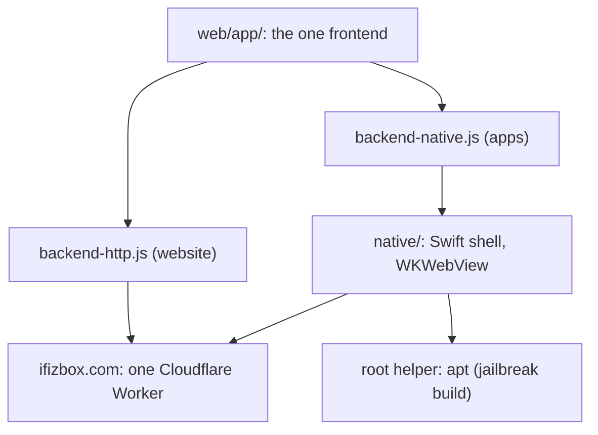

<p align="center"></p>

<h1 align="center">iFizBox</h1>

<p align="center"><b>A package manager with the iOS 6 look, for modern iPhones.</b><br>
Browse APT repos and AltStore sources, install tweaks on a jailbroken iPhone, and install apps signed with your own
certificate, on the website or in the sideloaded app.</p>

<p align="center"><b>Tweaks without a jailbreak:</b> pick a tweak from an APT repo (Havoc, Chariz, BigBoss) and
iFizBox injects it into an app you sign on the phone, with ElleKit bundled for tweaks that need it. Paid tweaks
too, bought with your repo account (Chariz, Havoc). Your own
<code>.deb</code>, <code>.dylib</code> or <code>.framework</code> works too, and the tweaks stay with the app when it's
re-signed. More on <a href="https://ifizbox.com/#/home/why">Why iFizBox</a>.</p>

<div align="center"><a href="https://ifizbox.com"></a>
<a href="https://github.com/RyanAHayden/iFizBox/releases/latest"></a>
<a href="LICENSE"></a>

<a href="https://discord.gg/3XASvpjbgp"></a></div>

<p align="center">
  
  
  
</p>

> [!NOTE]
> iFizBox is inspired by Cydia by Jay Freeman (saurik). It is **not affiliated with Cydia or SaurikIT**, and Cydia
> is SaurikIT's trademark. It uses Cydia's section icons and purpose badges and some of its interface wording, under
> GPLv3: see [Credits](#credits).

## Contents

- [The three builds](#the-three-builds)
- [Screenshots](#screenshots)
- [Install](#install)
- [How it works](#how-it-works)
- [Build and test](#build-and-test)
- [Host your own server](#host-your-own-server)
- [Project layout](#project-layout)
- [Contributing](#contributing)
- [Credits](#credits)
- [License](#license)

## The three builds

One frontend (`web/app/`, plain HTML, CSS and JavaScript modules with no build step) runs in all three.

| | Build | What it does | Needs |
|:-:|---|---|---|
|  | **Website**, [ifizbox.com](https://ifizbox.com) | Browse APT repos and AltStore sources, add your own, see what changed, search. Signs and installs apps **in your browser** with your certificate. No login. | Any iPhone with Safari |
|  | **Jailbreak app** (`iFizBox.deb`) | Everything the website does, plus `.deb`s through apt, background upgrade checks and Shortcuts. Installs IPAs without signing (AppSync Unified). | A rootless jailbreak (iOS 15 and later, `iphoneos-arm64`) |
|  | **Sideload app** (`iFizBox.ipa`, the LITE icon) | The same app without apt: signs, installs, re-signs and updates apps on the phone with your certificate. | Your own signing certificate (`.p12` and `.mobileprovision`) |

## Screenshots

**Website**

<p align="center">
  
  
  
  
</p>

**Jailbreak app**

<p align="center">
  
  
  
  
</p>

<details>
<summary><b>More screenshots</b></summary>

<p align="center">
  
  
  
  
</p>

<p align="center">
   Manage: add, edit and remove sources" width="24%">
  
   Signing: the certificate and its files" width="24%">
  
</p>

</details>

## Install

### Website

 Signing: Import Certificate" width="36%" align="right">

Open **<https://ifizbox.com>** in Safari. No install, no account.

To install apps, add your certificate under **Settings > Signing**. It stays in your browser.

<br clear="right">

### Jailbreak app (rootless, iOS 15+)

 Jailbroken? Install iFizBox: Add to Sileo, Add to Zebra, Copy Repo URL, Download .deb" width="36%" align="right">

On the website, tap **Home > Jailbroken? Install iFizBox**, or add this repo to Sileo or Zebra:

```text
https://ifizbox.com/repo/
```

Or `apt-get install ./iFizBox.deb` from the [latest release](https://github.com/RyanAHayden/iFizBox/releases/latest).

iFizBox then updates itself like any other package.

<br clear="right">

### Sideload app (LITE)

 Install iFizBox Lite" width="36%" align="right">

Add your certificate on the website, then tap **Home > Install iFizBox Lite**.

The app arrives with your certificate, sources and settings, and updates itself.

No certificate? [docs/developer-account.md](docs/developer-account.md).

Signed apps keep their own bundle ID, so they replace the originals. With a profile that has Push, App Groups with
groups assigned, and Communication and Time Sensitive Notifications (one explicit App ID in an Ad Hoc profile covers
every app, your own or a signing service's), they get their own notifications:
**Home > User Guides > Notifications for Signed Apps** and [docs/developer-account.md](docs/developer-account.md).

With a paid account's App Store Connect API key (**Apple Developer Account**, in Settings > Installation & Signing
in the app or Settings > Signing on the website), iFizBox makes each app's App ID and Ad Hoc profile itself and adds
your iPhone to the account: [docs/signing.md](docs/signing.md#own-provisioning-profiles-app-store-connect-api-key).

Also on Feather, AltStore or SideStore: `https://ifizbox.com/repo/source.json`

<br clear="right">

### Share your certificate

 Signing > Share Your Certificate" width="36%" align="right">

Have a developer account? Help your friends sideload with [SideDrop](https://github.com/RyanAHayden/sidedrop): a site
you run, where every app is signed for them with your certificate.

Share it only with people you trust: they can pull the certificate out.

<br clear="right">

## How it works

<!-- Experimental: if rendering fails, preview on GitHub -->


- **One frontend.** The UI only talks to a backend interface: `backend-http.js` on the website and
  `backend-native.js` in the apps. The parsing, version comparison, Changes and upgrade logic in `web/app/core/` is
  plain JavaScript tested with `node --test`.
- **The apps** are a Swift shell around a WKWebView that runs `web/app/`, built on Linux into both the rootless
  `.deb` (with a root helper for apt) and the sideload IPA (without it). They're designed to hold 120 Hz: animations
  use only transform and opacity, long lists are virtualised, and parsing runs in a Web Worker.
- **ifizbox.com is a single Cloudflare Worker** (`worker/`), with no server of our own:

  | Path | What it does |
  |---|---|
  | `/` | the website: `web/app/` as static assets, revalidated on every load |
  | `/api/fetch` | the website's fetch proxy (APT repos and AltStore sources don't let a page read them), kept off private addresses: Cloudflare's fetch can't reach private or loopback ones, and literal private hosts and `localhost` are refused up front (a self-hosted `node.mjs` also resolves and checks every host and redirect itself), with time limits and a 64 MB cap on plain fetches (IPAs up to `MAX_UPLOAD_MB`). A GitHub repo's details and releases (a repo added as a source) go through GitHub's API with the server's token, kept 10 minutes |
  | `/api/applookup`, `/api/appreviews`, `/api/ipainfo` | App Store details and reviews for an app, and an IPA's `Info.plist` (supported iOS versions) |
  | `/sign/status` | tells the sideload app's Settings > Installation & Signing the server answers |
  | `/sign/manifest`, `/sign/host/*` | the install manifest iOS needs when the app signs on the phone, and iFizBox's own update held for 10 minutes while iOS replaces the app |
  | `/sign/upload`, `/sign/up/*` | an app the website signed in the browser, held for 10 minutes for iOS's install prompt |
  | `/repo/` | iFizBox's flat APT repo, served from the latest GitHub release's assets |
  | `/repo/source.json` | iFizBox's AltStore source |
  | `/apple/*` | the website's App Store Connect calls with your own API key (Apple sends no CORS headers), and the free Apple ID sign-in relay where a deploy turns it on; allow-listed hosts and paths, nothing logged |
  | `/api/account/*` | iFizBox Account (below) |
  | `/reviews/*` | package reviews (Cloudflare D1) |

- **Signing happens on your own device.** The sideload app signs on the iPhone (the jailbreak app needs no
  signing: its helper installs IPAs directly). The website signs in the browser with
  [zsign](https://github.com/zhlynn/zsign) compiled to WebAssembly (`web/app/vendor/zsign`, built reproducibly by
  `tools/build-zsign-wasm.sh`). No server ever signs anything or sees your key. Details:
  [docs/signing.md](docs/signing.md).
- **iFizBox Account** ([docs/account.md](docs/account.md)) is optional. It syncs your sources, settings, certificate and repo
  sign-ins (Chariz, Havoc: the sign-in only; payment details stay on each iPhone), **end-to-end encrypted** with a key made on your device. Lose the key and nobody can recover the data.

   iFizBox Account: Create Account, Sign In With Key" width="33%">

- **Shortcuts, Siri and Spotlight:** Check for Updates, Add Source, Install All Updates, Respring and more
  ([docs/shortcuts.md](docs/shortcuts.md)).

## Build and test

Requirements: Python 3 (standard library only) and Node.js 22 or later.

```bash
tools/check.sh                 # the test gate: every test_*.py, node --test web/app, every worker/test*.mjs
node worker/node.mjs           # the website, /api/fetch and /sign/* on http://localhost:8787
cd worker && npx wrangler dev  # or the same Worker under Wrangler, as on ifizbox.com
```

`tools/check.sh` also rebuilds the zsign WebAssembly where Emscripten (`emcc`) is installed and fails if the
committed copy doesn't match its source. It also builds the native apps when their toolchain is set up, and says
what it skipped when it isn't.

<details>
<summary><b>Building the apps on Linux</b> (no Mac, no Theos)</summary>

`native/build.sh` builds both apps from one executable and checks them:

```bash
export SWIFT_TOOLCHAIN=<path/to/swift-6.4-toolchain>   # the dir holding usr/bin/swiftc
export IOS_SDK=<path/to/iPhoneOS.sdk>                  # extracted from an Xcode .xip
native/build.sh --probe     # says what is missing
native/build.sh             # native/build/iFizBox.deb and native/build/iFizBox.ipa (or: deb | ipa)
```

It also needs `ld64.lld` (rustup's, or one on `PATH`) and `ldid` or `rcodesign` to sign the entitlements. Full
notes: [docs/native.md](docs/native.md). Releases: [docs/release.md](docs/release.md).

</details>

## Host your own server

Anyone can run their own copy of the Worker for free and point iFizBox at it. Full guide:
[worker/README.md](worker/README.md).

[](https://deploy.workers.cloudflare.com/?url=https://github.com/RyanAHayden/iFizBox/tree/main/worker)

```bash
git clone https://github.com/RyanAHayden/iFizBox && cd iFizBox/worker
npx wrangler login
npx wrangler deploy     # creates the KV storage on the first deploy and prints your https://….workers.dev address
```

Or on your own machine or in Docker:

```bash
node worker/node.mjs    # PORT, HOST, HOST_IDS, TTL as in worker/wrangler.toml
docker build -f worker/Dockerfile -t ifizbox . && docker run -d -p 8787:8787 -v ifizbox-data:/data ifizbox
```

 Installation & Signing > Signing Server: Server, Check Server, Run Your Own" width="36%" align="right">

Then in the sideload app: **Settings > Installation & Signing > Signing Server**, paste your address and tap **Check Server**. iOS accepts
install manifests only over HTTPS with a trusted certificate, so a self-hosted Node server has to sit behind
Tailscale, a Cloudflare Tunnel or a reverse proxy with a real domain.

ifizbox.com itself is deployed on release tags, not on pushes to `main`: `tools/publish.sh` runs
`tools/deploy.sh vX.Y.Z` after tagging a release, which checks the tag out and runs
`tools/buildinfo.sh && cd worker && npx wrangler deploy -c wrangler.ifizbox.toml`.

<br clear="right">

## Project layout

| Path | What's there |
|---|---|
| `web/app/` | the one frontend: screens, iOS 6 CSS, `core/` (pure JS, `node --test`), `brand.js` (name, domain, IDs) |
| `worker/` | the ifizbox.com Cloudflare Worker, and `node.mjs` to run it on Node |
| `native/` | the Swift shell, the root helper, `build.sh` for the `.deb` and the IPA |
| `tools/` | the test gate, release and icon scripts, the zsign WebAssembly build |
| `docs/` | design notes: [Cydia's behaviour](docs/cydia.md), [Sileo and Zebra](docs/sileo-zebra.md), [native](docs/native.md), [signing](docs/signing.md), [sideload](docs/sideload.md), [settings](docs/settings.md), [account](docs/account.md), [Shortcuts](docs/shortcuts.md), [releases](docs/release.md) |
| `testrepo/` | sample APT and AltStore sources for the tests |

## Contributing

Work is planned in `plan/TODO.md` and run by [agent-runner](https://github.com/FIZL0/agent-runner)
(`tmux new -s ifizbox agent-runner run 3`). The rules every change follows are in [AGENTS.md](AGENTS.md). The
short version: iOS 6 is the base style, the gate (`tools/check.sh`) must pass, the Python stays standard-library
only, and no Apple artwork or Cydia logo goes into the repository.

Bugs and ideas: [GitHub issues](https://github.com/RyanAHayden/iFizBox/issues) or the
[Discord](https://discord.gg/3XASvpjbgp).

## Credits

- Inspired by **Cydia** by Jay Freeman (saurik). iFizBox is not affiliated with Cydia or SaurikIT, and Cydia is
  SaurikIT's trademark. The interface is redrawn in CSS and SVG, and no Apple artwork is included. From Cydia's
  GPLv3 source iFizBox uses:
  - its section icons and purpose badges (`web/app/icons/sections/`), copied unchanged; credit and details are in
    [that folder's README](web/app/icons/sections/README.md);
  - some of its interface wording (titles, buttons and alert sentences, listed in
    [docs/cydia.md](docs/cydia.md#ui-strings)), with typos fixed.
- The phone in the screenshots is the iPhone 5 from Teehan+Lax's iOS 6 GUI PSD. Only the rendered screenshots are
  in the repository, not the kit.
- [zsign](https://github.com/zhlynn/zsign) (MIT) and OpenSSL (Apache-2.0) in the website's signer, with their licences
  in `web/app/vendor/zsign/`.
- [ElleKit](https://github.com/tealbathingsuit/ellekit) (BSD-3-Clause) by Évelyne Bélanger, bundled for tweak
  injection: its `libellekit.dylib` goes into a signed app when an injected tweak needs CydiaSubstrate and none was
  added. The package and its licence are in `web/app/vendor/ellekit/`.

## License

[GPL-3.0-or-later](LICENSE). Anyone who distributes iFizBox or a modified version must release the source under the
same license.
