# D29: README crops on mobile

On GitHub mobile the README's right-floated screenshots left a sliver of text beside them. On a ~360px screen the
five floats were 300px wide, so the text column was about 40px and broke words mid-word ("Ope n", "Safa ri"). The
account crop, set at a fixed 280px, was nearly full width inside its list item.

## What was done

- `README.md`: the five right-floated crops (crop-web-certificate, crop-jb-sheet, crop-web-lite,
  crop-share-certificate, crop-signing-server) go from `width="300"` to `width="36%"`, still `align="right"`.
  The account crop (crop-account, inside a list item, not floated) goes from `width="280"` to `width="33%"`.
- GitHub strips CSS, so the width is an HTML attribute, and a percentage is what scales with the screen.
- Why 36% and not the "about 40%" first picked: the floats should also stay about 300px on desktop. At 40% they were
  about 356px in an 890px content column (about 335px in GitHub's ~838px column on a wide screen). At 36% they are
  320px at a 1000px window, about 302px in the 838px column, and about 126px on a 390px phone, leaving a text column
  of about 220px beside them.
- Why 33% for the account crop: the fixed 280px was also too big. At 40% and 36% the account crop was larger than
  280px on desktop (about 340px and 307px). At 33% it is about 281px at 1000px and about 116px on a 390px phone.
  35% was tried first and dropped.
- The 30% hero row and the 24% screenshot rows were already fine at both widths, so they are unchanged.
- `journal/2026-11-23-d29-readme-mobile-widths/`: this file and the before/after PNGs.

## How it was checked

- Rendering: GitHub's own markdown API (`gh api markdown -f mode=markdown -F text=@README.md`, the README-file mode;
  gfm mode adds hard line breaks). The HTML was wrapped in github-markdown-css 5.5.1 (light), with images loaded
  through a file:// base href and the `
` blocks forced open so "More screenshots" shows. "Before" is main's
  README. Headless Chromium took the shots.
- A measuring mistake, found and fixed: headless Chromium lays out no narrower than about 500px, so the first "390px"
  shots were a ~500px layout cut down to 390px, and images and tables looked wider than they would on a phone. The
  final render pins the article's CSS width: 390px with GitHub's 16px mobile padding, and for the 1000px shots GitHub's
  980px max width with 45px padding. Images are measured from 1px marker pixels the page draws at each image's top and
  bottom on the left edge (the tiny dots at the left edge of some shots). Positions read with `--dump-dom` were also
  wrong, since it lays out at a different size, so they were not used.

Install section, before and after:

- At 390px: 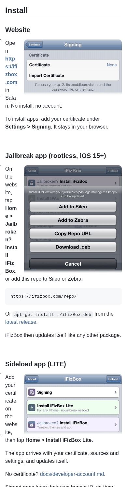 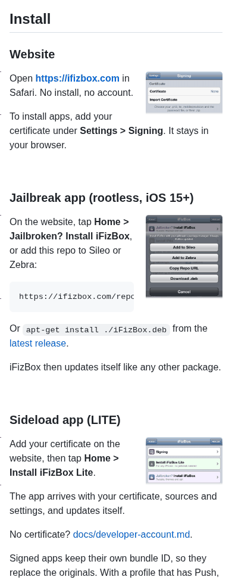
  [install-390-before.png](install-390-before.png) and [install-390-after.png](install-390-after.png). Before, the text
  column was about 40px and words broke mid-word. After, it is a readable column beside the crop.
- At 1000px, scaled to 60%: 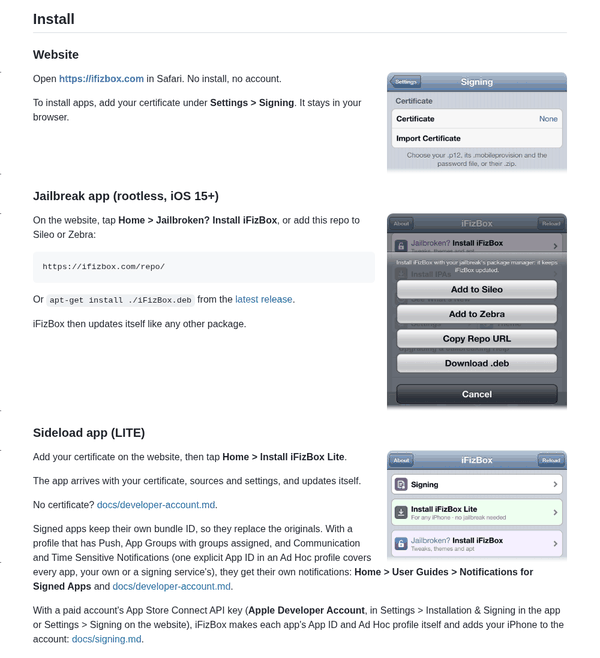 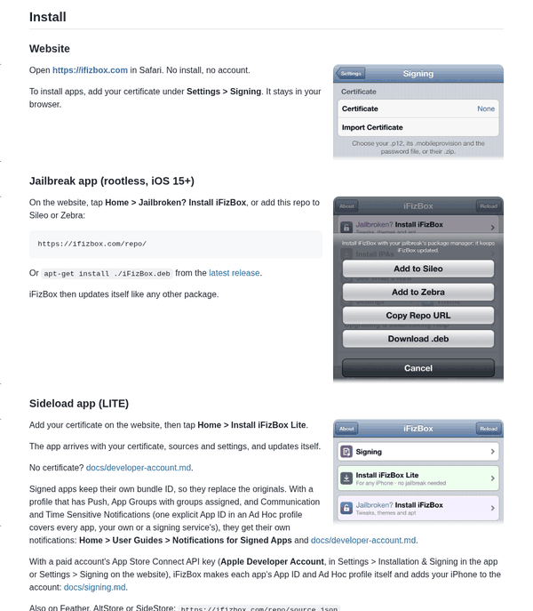
  [install-1000-before.png](install-1000-before.png) and [install-1000-after.png](install-1000-after.png).

Account crop, before and after:

- At 390px: 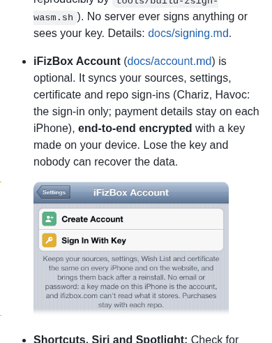 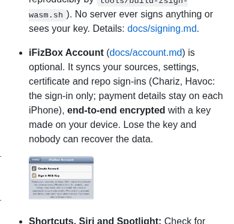
  [account-390-before.png](account-390-before.png) and [account-390-after.png](account-390-after.png).
- At 1000px, scaled to 60%: 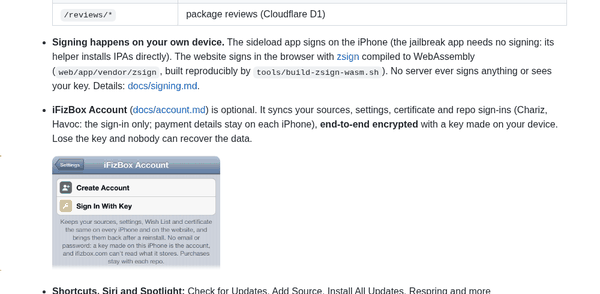 
  [account-1000-before.png](account-1000-before.png) and [account-1000-after.png](account-1000-after.png).

Rows, after the change. They are unchanged by it and read fine at both widths: four phones per row with captions,
small but distinguishable on a phone.

- Hero row at 30%: 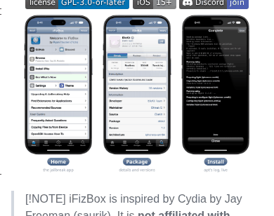 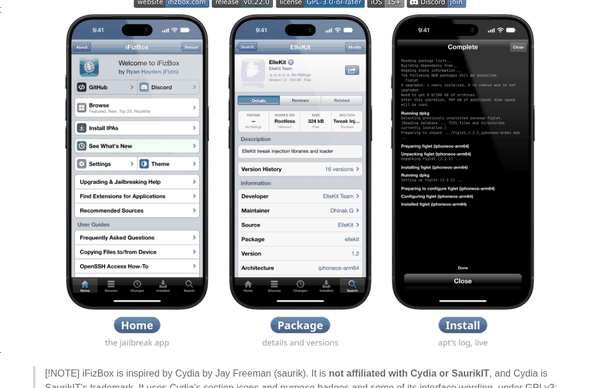
  [rows-30-390.png](rows-30-390.png) and [rows-30-1000.png](rows-30-1000.png).
- Website, Jailbreak app and expanded More screenshots rows at 24%: 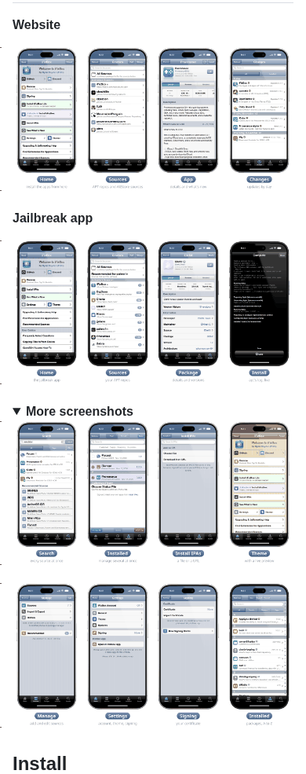 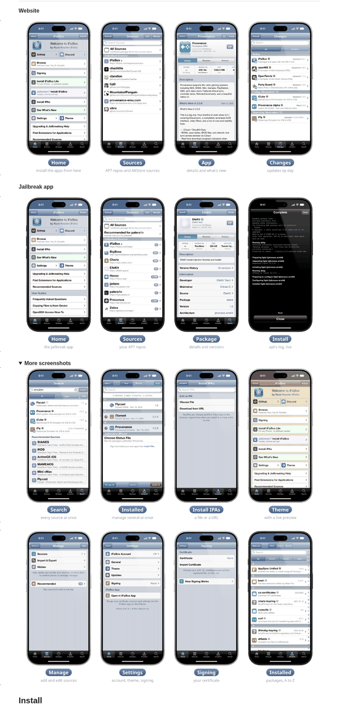
  [rows-24-390.png](rows-24-390.png) and [rows-24-1000.png](rows-24-1000.png).

## Not verified

- github.com on a real phone. The page only shows after merge and publish. The render used GitHub's API HTML with
  github-markdown-css, not github.com's full page chrome, so the column widths are approximate.
- The `[!NOTE]` alert shows as raw text in the local render, because the markdown API does not render alerts. github.com
  does render them. This is a render artifact, not a README problem.

## Seen, not changed

- The code block beside the jailbreak sheet float scrolls sideways at 390px. It is a `pre`, so it scrolls inside
  itself, and the page does not scroll.
- The "three builds" table is cramped at 390px.
