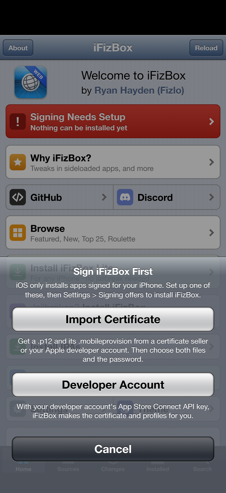
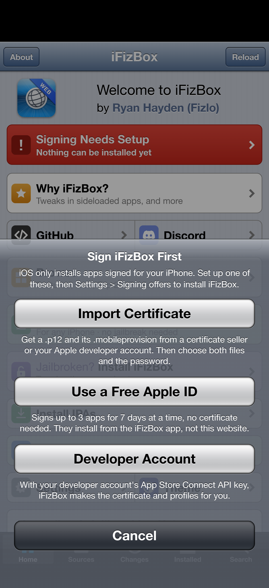
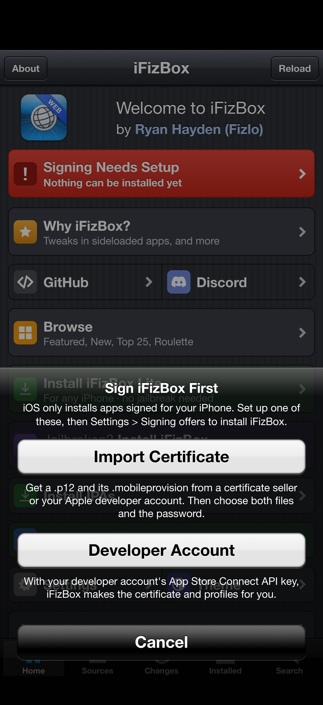
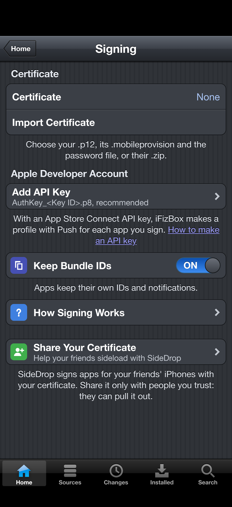

# F385: sign-first sheet on the website

## What changed

- `web/app/screens/home.js` `installApp`: when signing isn't ready, it now awaits `signFirstSheet`
  (`web/app/signing-sheet.js`) instead of navigating straight to Settings > Signing.
- Use a Free Apple ID is offered only when `relayAvailable()` in `free-apple-id.js` is true (the Worker's
  `/apple/status`), the same condition that makes Settings > Signing show its free group.
- A pick calls `rememberInstall` (unchanged, so Signing still offers Install Now), then goes to
  `/home/settings/signing` and calls `focusSigningGroup(id)`, which scrolls that way's group into view
  (`.sign-import`, `.free-route`, `.asc-add` or `.asc-guide-link`).
- Cancel returns `"cancelled"` and stays on Home.
- The sheet reuses the iOS 6 action-sheet classes (`action-scrim`, `action-sheet`, `action-title`,
  `action-button`, `cancel` from `packages.css`), with a new `.action-hint` line under each button
  (`signsheet.css`). The hint is centred, in the title's colour tokens, one per option, one or two sentences
  (AGENTS.md hint rules). The Free Apple ID hint repeats the words of `FREE_ENTRY_FOOTER` in `free-apple-id.js`.
- Tests: `web/app/screens/signfirst.test.js` covers sheet instead of navigation, Cancel, pick (remember, go,
  focus), ready (install), relay failure (no free option), option order and hints, and focus polling.
  `siteinstall.test.js` and `installnow.test.js` now stub the sheet's pick.
- `node --test web/app`: 3342 pass, 0 fail.

## Shots

Captured with the journal copy of the F382 `capture.mjs` (adds `doc:` tap selectors for elements outside the
page), against `python http.server` on `web/app`, site mode, driven by `shots.json`.

The sheet on the real tap path with the relay off, so there is no free option.

The sheet with the free option, opened by calling `signFirstSheet({free: true})` from an eval, since a static
server has no `/apple/status`.

The sheet in the dark appearance.

Signing after the Developer Account pick, with the page fitting on screen.

## Tried / notes

- The local static server answers no `/apple/status`, so `shots-free.json` fakes it in the page (a `fetch`
  wrapper answering `{"on": true}`, then `resetRelayAnswer()`) and taps the real Install iFizBox Lite tile:
  sheet-free-tap.png shows all three ways. Tapping Use a Free Apple ID landed on Signing with the page scrolled
  so the Free Apple ID group sits mid-screen (after-free-apple-id.png). That is the scroll-to-group working.
- A Developer Account pick lands on a Signing page that fits on screen, so no scroll shows in that shot.
- "Each option opens its page": all three ways are groups on the one Settings > Signing page (none has a page
  of its own), so a pick opens Signing and scrolls to that group.
- After the spec review: the certificate group is found by its `.mobileprovision` file input, because
  `.sign-import` also marks other rows. The free option also needs `!nativeBridge()`, as signing.js does. A test
  pins the free hint to `FREE_ENTRY_FOOTER`.

## Not verified

- On a real iPhone Safari. Web changes are checked in Chromium only.
- The free option against the real Worker relay (only a faked `/apple/status`; no Worker run locally).
- The iOS 7 and iOS 13 era looks of the sheet. The first iOS 26 shot showed that the later eras draw no panel
  behind an action sheet, so the title and hints were unreadable over the page. signsheet.css now puts them on
  button-coloured cards in the ios7/ios13/ios26 eras. sheet-ios26.png (eval-opened, light) shows the fix. iOS 7
  and 13 use the same rule but were not shot.
