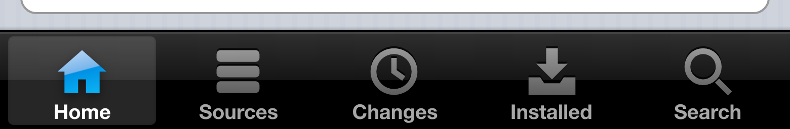
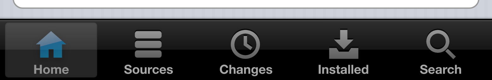
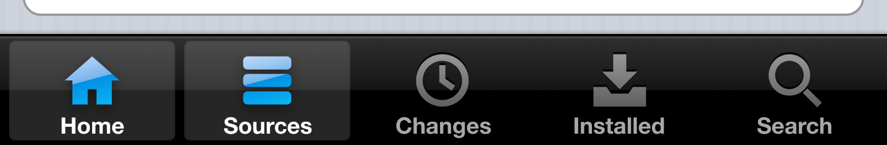
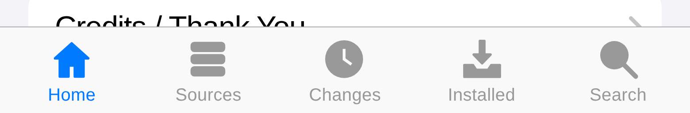
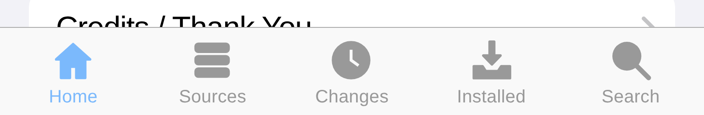
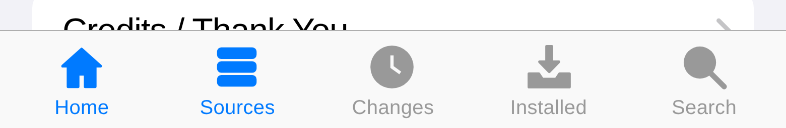

# B465: some buttons took a tap without showing their pressed state

The user reported that some buttons on Home and Settings took a tap but did not show that they were held down.

## What the probe found

A Chromium probe ([probe.mjs](probe.mjs), built from the setup in `tools/smoke/smoke.mjs`: fake bridge, 390x844;
run `node probe.mjs web/app`, with `STYLE=ios13` and `HASHES="#/home,#/sources"` to choose) pressed every visible tappable thing on Home, Settings and Sources with CDP mouse events at the centre, the
4 edge midpoints and the 4 corners (1 px in), with clicks blocked. It compared the computed styles (background, color,
opacity, filter, box-shadow, transform, border-image, ::before and ::after) of the control and its children before and
while held, in the iOS 6 and iOS 13 styles.

A first version on a 6 px grid over the whole screen was far too slow: it was killed by its 900 s timeout and printed
nothing.

- Every bar button, row, Home tile (Settings and Theme included) and alert or action button showed its pressed look at
  every point tested.
- Only the tab bar items (Home, Sources, Changes, Installed, Search) showed nothing anywhere. `a.tab` was not in
  `PRESSABLE` in `web/app/app.js`, and `web/app/ios6.css` had no held rule for tabs.

So the cause was not an offset hit area or a covering child. A control kind was missing.

"Settings" in the report most likely means the Settings tab on the iOS 26 native tab bar, or the Home tab. On the web
tab bar, Settings is not a tab: it lives on Home's stack.

## Fix

- `web/app/app.js`: `PRESSABLE` gains `a.tab`.
- `web/app/ios6.css`: a held tab (`.tab.is-pressed`) wears the selected tab's look, with the same rules as `.tab.active`
  (the white-15% band, and the active text and icon colours through the tokens, so iOS 7 and 13 get their blue tint
  too).
- The tab that is already chosen has no further look to take. Held, it dims its icon and label to opacity .5; otherwise
  pressing Home while on Home showed nothing.

The probe was run again after the fix: every tab showed its held look in both styles.

## Test

`web/app/press-hitbox.test.js` builds each control's markup as small fake elements (the tab bar item, read from
`web/app/nav/tabbar.js`'s own markup; bar button; back button; rows; Home tile; alert; action sheet button; Delete
confirm). It checks that a press on any part of a control resolves through `closest(PRESSABLE)` to the control. It also
checks that the tab bar's click handler's selector is in `PRESSABLE`, and that every `.tab.active` rule in `ios6.css`
has a `.tab.is-pressed` twin, including the held chosen tab's dim.

## Left as is

- The by-line text link on Home ("Ryan Hayden (Fizlo)" style credit link) and the search field's label show no pressed
  look. They are a text link and a text field, not buttons, and iOS draws no pressed look for them either.

## Not verified

- On a real phone (iPhone 7 or 15). The change is web CSS and JS only, and Chromium covers it, so no phone run was made.
- The iOS 26 style uses a native `UITabBar` (F369), which this web fix does not touch. If the user's "Settings" meant
  that bar, it is not covered here.
- iOS 13's `.active` glyphs are the same as its plain ones, so a held tab there already wears the full selected look.
  iOS 7 (`ios7.css`) does swap to a filled glyph for `.active`, and that swap is not mirrored for `.is-pressed`, so
  only the colour changes while a tab is held. That is outside this task's files and styles: filed as a follow-up.
- The node test (`press-hitbox.test.js`) checks which element a press marks, not geometry: node has no layout. The
  edge and centre geometry check is the probe above, run by hand (it needs Chromium, like `tools/smoke`).

## Screenshots

iOS 6 style, at rest and held on Home and Sources:

- 
- 
- 

iOS 13 style, at rest and held on Home and Sources:

- 
- 
- 
